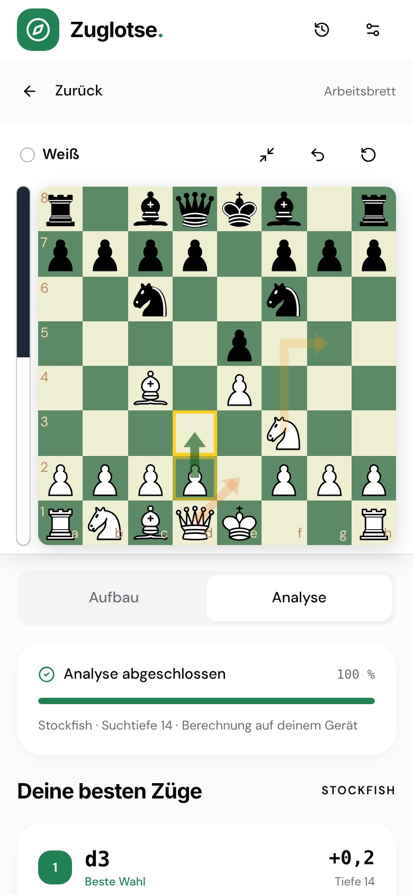
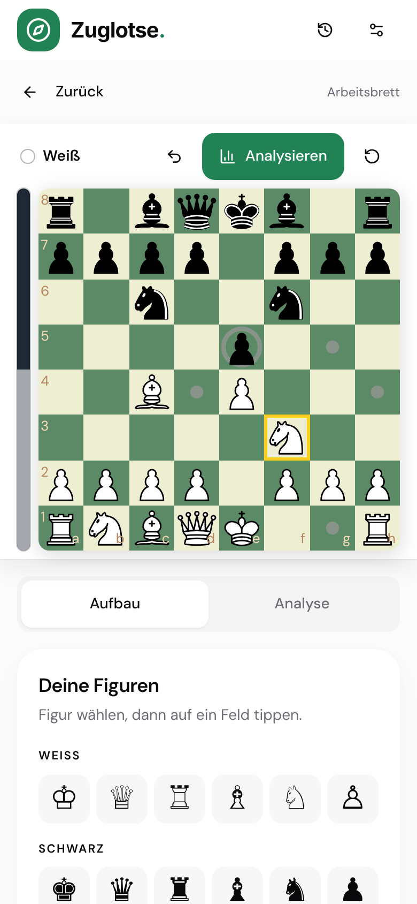
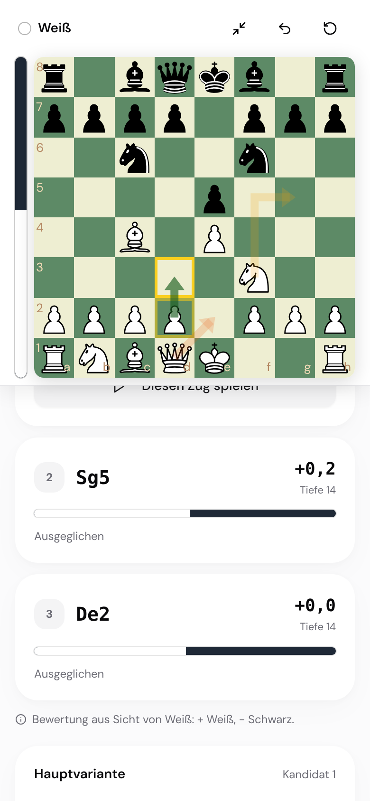
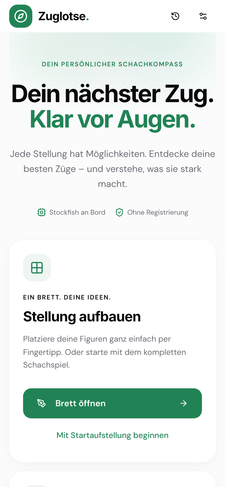
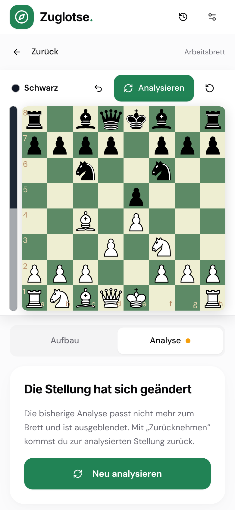
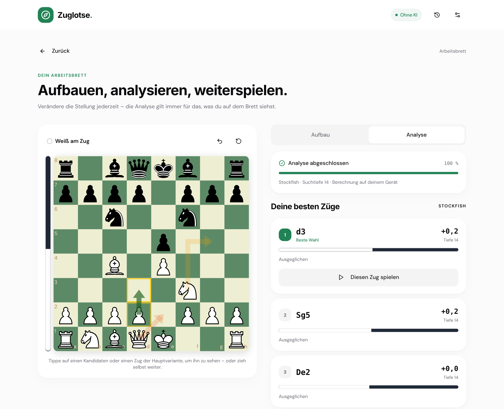

# Zuglotse – Dein Schachkompass (Webapp)

**Zuglotse** ist eine mobile-first Webanwendung zur Analyse von Schachstellungen. Sie läuft **vollständig clientseitig im Browser** – ohne Server-Backend, ohne Datenbank und ohne Registrierung. Am bequemsten ist sie als Home-Screen-App auf dem iPhone, sie funktioniert aber genauso auf iPad und Desktop.

**Live:** <https://astromatz.github.io/zuglotse/>

<p align="center">
  
  &nbsp;
  
  &nbsp;
  
</p>

## ✨ Funktionen

* **Stellung aufbauen:** Figuren per Palette setzen, aus der Startaufstellung beginnen, eine FEN einfügen oder (mit eigenem KI-Schlüssel) ein Foto des Bretts erkennen lassen.
* **Zwei Modi – „Aufbauen“ und „Spielen“:** Beim Aufbauen werden Figuren frei gesetzt, versetzt und entfernt, das Zugrecht ist umschaltbar. Beim Spielen zieht nur die Seite am Zug, und zwar regelkonform: Figur antippen → graue Punkte zeigen die möglichen Züge → Zielfeld antippen (inklusive Rochade, En passant und Umwandlungsauswahl).
* **Eine Hauptschaltfläche unter dem Brett:** Sie zeigt immer den sinnvollsten nächsten Schritt – Stellungsfehler beheben, analysieren, laufende Analyse abbrechen oder den besten Zug spielen.
* **Stellungsfehler auf dem Brett:** Fehlt ein König, steht ein Bauer auf der Grundreihe oder steht die falsche Seite im Schach, werden die Felder rot markiert und die Korrektur liegt auf der Hauptschaltfläche. Rochade und En passant hält die App automatisch plausibel (einsehbar unter „Details“).
* **Analyse mit Stockfish:** Die Engine läuft lokal als WebAssembly im Browser und liefert die drei besten Kandidatenzüge mit Bewertung, Pfeilen auf dem Brett und Hauptvariante. Ein Tipp auf einen Variantenzug zeigt die Stellung dazu als Vorschau.
* **Dialog statt Einbahnstraße:** Aufbauen, analysieren, einen Zug spielen („Diesen Zug spielen“), den Gegenzug selbst ziehen, neu analysieren – alles auf einem Arbeitsbrett. Ändert sich die Stellung, wird die Analyse als veraltet ausgeblendet (eine laufende Berechnung wird abgebrochen). Mit „Zurücknehmen“ geht es Schritt für Schritt zurück; kommt man auf die analysierte Stellung zurück, ist die Analyse sofort wieder gültig.
* **Brett und Bedienung im Blick:** Auf dem Smartphone bleibt das Brett oben am Bildschirm stehen, während du die Erläuterungen liest (umschaltbar zwischen groß und kompakt). Im Aufbau bleibt mehr Platz für die Figurenpalette. Ab Tablet-Breite und im breiten Smartphone-Querformat steht das Brett links, die Analyse rechts; bei sehr geringer Höhe lässt sich alles frei scrollen. Die Kandidaten sind kompakt auswählbar, gespielt wird mit der Hauptschaltfläche unter dem Brett.
* **Erklärungen:** Deterministische deutsche Stellungskommentare und Eröffnungsprinzipien – ohne KI und ohne Netzwerk.
* **Optionale KI-Erklärung:** Anbindung von Google Gemini oder OpenAI über den eigenen API-Schlüssel (Bring Your Own Key). Der Schlüssel bleibt im lokalen Browser-Speicher (`localStorage`). Anfragen haben eine Zeitbegrenzung; beim Wechseln der Stellung oder des Arbeitsbereichs werden überholte Fotoantworten verworfen.
* **Verlauf:** Analysierte Stellungen werden lokal gespeichert und lassen sich wieder öffnen. Export als FEN oder PGN.

## 🖼️ Ansichten

| Start | Analyse (veraltet nach einem Zug) |
|:---:|:---:|
|  |  |

**Desktop / iPad:** Brett links, Analyse rechts.



## 🔒 Datenschutz

Stellungen, Verlauf (`chess_history`) und Einstellungen bleiben auf deinem Gerät. Wenn du die optionale KI nutzt, gehen die Stellung und die Kandidaten direkt an die von dir gewählte Schnittstelle (Gemini oder OpenAI) – an keinen anderen Server.

---

## 🚀 Hosting auf GitHub Pages

Die Webapp ist für das Hosting auf **GitHub Pages** vorbereitet. Die Veröffentlichung läuft über GitHub Actions: Bei jedem Push auf `main` baut GitHub die App und passt den Pfad (`basePath`) automatisch an den Repository-Namen an.

1. **Repository auf GitHub anlegen** und diesen Ordner dorthin pushen:
   ```bash
   git init
   git add .
   git commit -m "Initial commit Zuglotse Webapp"
   git branch -M main
   git remote add origin https://github.com/<DEIN-NUTZERNAME>/<DEIN-REPO>.git
   git push -u origin main
   ```
2. **GitHub Pages aktivieren:** In den Repository-Einstellungen unter **Settings → Pages → Build and deployment → Source** den Eintrag **GitHub Actions** wählen. Der Workflow [`.github/workflows/deploy.yml`](.github/workflows/deploy.yml) startet dann automatisch.
3. **Fertig:** Nach etwa 1–2 Minuten ist die App unter `https://<DEIN-NUTZERNAME>.github.io/<DEIN-REPO>/` erreichbar.

> **Hinweis für die Home-Screen-App auf dem iPhone:** Die App hat keinen Service Worker. Nach einem Update die App komplett aus dem App-Umschalter schließen und neu öffnen, dann läuft die neue Version.

---

## 🛠️ Lokale Entwicklung & Build

```bash
# 1. Abhängigkeiten installieren
npm install

# 2. Lokalen Entwicklungsserver starten
npm run dev
# Browser öffnen unter: http://localhost:3000

# 3. Statischen Export für GitHub Pages / Webhosting erstellen
npm run build
# Der fertige statische Build liegt anschließend im Ordner /out
```

Den statischen Build kannst du lokal mit `npx serve out` testen. Tests der Stellungslogik, des Engine-Starts, der Abbruchbehandlung und der Anfrage-Zeitbegrenzung: `npm test` (Node ≥ 22). Stockfish wartet auf `uciok` und `readyok`; nach einem Lade- oder Worker-Fehler lässt sich die Analyse ohne Neuladen erneut starten. Die angezeigte Suchtiefe bleibt der jeweiligen Berechnung zugeordnet.

**Technik:** Next.js 16 (statischer Export), React 19, TypeScript, Tailwind CSS 3.4, [chess.js](https://github.com/jhlywa/chess.js) für Regeln und Zuggenerierung, [react-chessboard](https://github.com/Clariity/react-chessboard) für das Brett, Stockfish (WebAssembly, Web Worker).

---

## 📁 Projektstruktur

```text
├── .github/workflows/deploy.yml   # Automatischer GitHub-Pages-Deploy
├── app/
│   ├── _components/
│   │   ├── chess-app.tsx          # Arbeitsbrett: Start, Aufbau, Analyse, Dialoge
│   │   ├── piece-palette.tsx      # Figurenauswahl
│   │   └── mode-sheet.tsx         # Einstellungen / KI-Schlüssel
│   ├── fonts/                     # Schachsymbol-Schriftart (mitgebündelt)
│   ├── globals.css                # Farben, Tokens, Layout des festen Bretts
│   ├── layout.tsx                 # HTML-Grundgerüst & Metadaten
│   ├── manifest.ts                # Web-App-Manifest (Home-Screen)
│   ├── opengraph-image.tsx        # Social-Vorschaubild
│   └── page.tsx                   # Einstiegsseite
├── components/
│   ├── chess/                     # Brett, Kandidatenliste, Varianten, Erklärungen, Dialoge
│   └── ui/                        # Button, Dialog, Toasts
├── hooks/
│   ├── useChessBoard.ts           # Stellung, Tippen/Ziehen, Zurücknehmen
│   ├── useStockfish.ts            # Engine-Steuerung (Web Worker)
│   ├── useAiExplanation.ts        # Optionale KI-Erklärung
│   └── useHistory.ts              # Lokaler Verlauf
├── lib/
│   ├── chess-utils.ts             # FEN, Prüfungen, Zielfelder, Zugausführung
│   ├── local-commentary.ts        # Deutsche Stellungskommentare
│   ├── opening-principles.ts      # Eröffnungen & Prinzipien
│   ├── position-repair.ts         # Korrektur erkannter Fotostellungen
│   ├── ai-providers.ts            # Gemini / OpenAI
│   └── stockfish-worker.ts        # Auswertung der Engine-Ausgabe
├── docs/screenshots/              # Bilder für diese README
├── public/                        # Icons, Manifest-Bilder, Stockfish (.js/.wasm), .nojekyll
├── next.config.js                 # Static-Export & BasePath
└── tailwind.config.ts             # Designsystem
```

---

## 🔒 Besonderheiten für GitHub Pages

1. **`.nojekyll`:** GitHub Pages würde sonst Ordner mit Unterstrich (`_next/`) ignorieren. Die Datei liegt bereits in `public/`.
2. **WebAssembly & Web Worker:** Stockfish wird als Web Worker geladen. `hooks/useStockfish.ts` ermittelt die URL zur Laufzeit, sodass die Engine sowohl auf der Domain-Wurzel als auch unter `/<repo-name>/` funktioniert.

## 📜 Lizenzen

Stockfish steht unter der GPL. Die mitgelieferte Schachfigur-Schrift hat eine eigene Lizenz, siehe [`app/fonts/zuglotse-pieces-license.txt`](app/fonts/zuglotse-pieces-license.txt).
